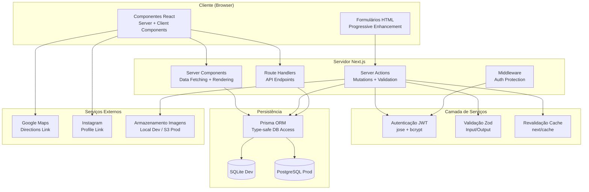

# Arquitetura do Sistema LOMA

## Visão Geral

Arquitetura modular full-stack monólito baseada em Next.js 16 App Router, com separação clara entre camadas de apresentação, regras de negócio, persistência e serviços externos.



## Decisões Arquiteturais

### 1. Next.js App Router + Server Components
**Justificativa**: Renderização no servidor por padrão, streaming, caching granular, SEO nativo, menos JS no cliente.

### 2. Server Actions para Mutações
**Justificativa**: 
- Single round-trip (UI + data)
- Progressive enhancement (funciona sem JS)
- Validação no servidor obrigatória
- Revalidação de cache integrada (`revalidatePath`)

### 3. Prisma ORM com SQLite (dev) / PostgreSQL (prod)
**Justificativa**: 
- Type-safety end-to-end
- Migrações versionadas e reproduzíveis
- SQLite: zero-config para desenvolvimento local
- PostgreSQL: padrão da indústria para produção

### 4. JWT em Cookie HttpOnly para Sessões
**Justificativa**: 
- Sem dependência de serviço externo (Auth0, Clerk, etc.)
- Controle total sobre expiração, rotação, revogação
- Seguro contra XSS (HttpOnly) e CSRF (SameSite=Lax)
- Simples de auditar e manter

### 5. Validação Zod em Todas as Server Actions
**Justificativa**: 
- Schema único = fonte da verdade
- TypeScript inference automática
- Validação input + output
- Mensagens de erro em pt-BR

### 6. Preços em Centavos (Integer)
**Justificativa**: 
- Evita erros de ponto flutuante (0.1 + 0.2 !== 0.3)
- Operações monetárias seguras
- Formatação apenas na apresentação (`formatPrice`)

## Fluxo de Dados

### Leitura Pública (Server Components)
```
Request → Server Component → getPublishedCategoriesWithItems() → Prisma → SQLite → JSON → Render HTML → Stream to Client
```

### Escrita Administrativa (Server Actions)
```
Form Submit → Server Action → requireAuth() → Zod Validate → Prisma Mutation → Audit Log → revalidatePath() → Redirect/Refresh
```

### Autenticação
```
Login Form → loginAction → bcrypt.verify → createSession (JWT) → setSessionCookie (HttpOnly) → redirect('/admin')
Admin Layout → getAdminSession → verifySession(JWT) → Session ou redirect('/admin/login')
```

## Estratégia de Cache e Revalidação

| Operação | Cache | Revalidação |
|----------|-------|-------------|
| Páginas públicas (Server Components) | Default: `force-cache` (build) | `revalidatePath` em Server Actions |
| Route Handlers GET | `force-static` ou `no-store` | Manual via `revalidateTag` |
| Server Actions POST/PUT/DELETE | Never cached | `revalidatePath` explícito |
| Assets estáticos (`/public`, `/uploads`) | Long-term (hash no filename) | Novo upload = novo nome |

**Princípio**: Nunca servir dados stale após mutação administrativa. Cada Server Action que modifica dados publicados chama `revalidatePath` nas rotas afetadas.

## Organização de Diretórios

```
src/
├── app/                      # Next.js App Router (file-system routing)
│   ├── (public)/             # Rotas públicas (layout compartilhado)
│   │   ├── cardapio/
│   │   ├── sobre/
│   │   ├── galeria/
│   │   ├── visite-nos/
│   │   ├── layout.tsx        # Header + Footer
│   │   └── page.tsx          # Home
│   ├── admin/                # Rotas administrativas (layout protegido)
│   │   ├── login/
│   │   ├── menu/
│   │   ├── media/
│   │   ├── settings/
│   │   ├── layout.tsx        # Auth guard + Sidebar
│   │   └── page.tsx          # Dashboard
│   ├── api/                  # Route Handlers (REST-like)
│   │   └── admin/
│   ├── globals.css           # Design tokens + Tailwind v4
│   ├── layout.tsx            # Root layout + metadata + Schema.org
│   └── page.tsx              # Home (redirects to (public))
├── actions/                  # Server Actions (use server)
│   ├── auth.ts
│   ├── categories.ts
│   ├── menuItems.ts
│   ├── media.ts
│   └── settings.ts
├── components/
│   ├── ui/                   # Primitivos reutilizáveis
│   ├── Header.tsx
│   └── Footer.tsx
├── lib/
│   ├── auth.ts               # JWT session management
│   ├── db.ts                 # Prisma singleton
│   ├── public-data.ts        # Server Components data fetching
│   ├── validations.ts        # Zod schemas + helpers
│   └── utils.ts              # Utilitários (cn)
prisma/
├── schema.prisma             # Schema + migrations
└── seed.ts                   # Seed idempotente
```

## Integrações Externas

| Serviço | Uso | Implementação |
|---------|-----|---------------|
| Google Maps | Link "Como chegar" | `https://www.google.com/maps/dir/?api=1&destination=<encoded_address>` |
| Instagram | Link de perfil + galeria | `<a href="https://instagram.com/lomacozinha" target="_blank" rel="noopener">` |
| Fonts (Google) | Playfair Display + Inter + JetBrains Mono | `@import` em `globals.css` com `preconnect` |
| Armazenamento Imagens | Upload local (dev) / S3 (prod) | `src/actions/media.ts` - abstrair para provider |

## Limitações Conhecidas

1. **Upload local** - Não persiste em deploys serverless/ephemeral (Vercel, Railway). Configurar S3/Cloudinary para produção.
2. **Sem email** - Recuperação de senha não implementada (requer SMTP real).
3. **Single-instance rate limit** - Em memória, não funciona em múltiplas instâncias. Usar Redis em produção.
4. **Sem CDN de imagens** - Sharp otimiza no upload, mas servir via CDN recomendado para produção.
5. **Canonical URLs** - Requer `NEXT_PUBLIC_SITE_URL` configurado corretamente.

## Evolução Futura

- [ ] Migrar upload para provider S3-compatível
- [ ] Adicionar Redis para rate limit distribuído
- [ ] Implementar webhook de revalidação (ISR on-demand)
- [ ] Adicionar observabilidade (logs estruturados, métricas)
- [ ] Internacionalização (i18n) se necessário